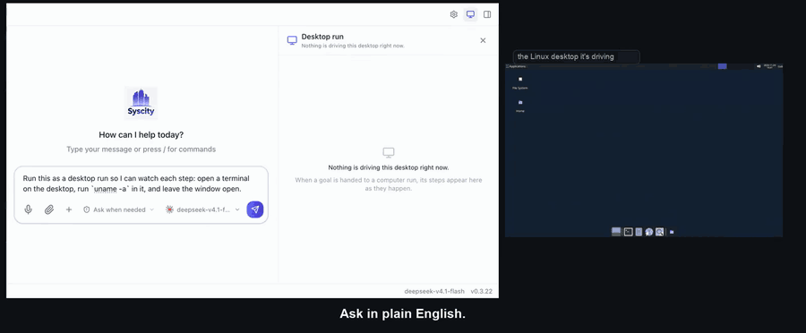

<p align="center">
  
</p>
<h1 align="center">Syscity - AI Agent System</h1>

<p align="center">
  <a href="https://github.com/lightconsen/syscity/actions/workflows/ci.yml">
    
  </a>
  <a href="https://github.com/lightconsen/syscity/blob/main/LICENSE">
    
  </a>
  <a href="https://img.shields.io/github/stars/lightconsen/syscity">
    
  </a>
  <a href="https://discord.gg/aaXghvzD">
    
  </a>
  <a href="https://github.com/lightconsen/syscity#requirements">
    
  </a>
</p>

Syscity is an **agent system** — a runtime that lets AI agents act on your computer. Unlike chatbots that only read and write text, Syscity agents can **control your desktop**, **execute code**, **operate your browser**, and **manage your files**.

Traditional AI lives inside a browser tab. Syscity lives inside your machine.

**One agent runtime, every device.** Run the same local agent on **macOS**, **Windows**, **Linux**, **iOS**, and **Android** — your data, memory, and tools stay on your machine. What leaves it goes where you point it: your model provider, and any chat channel or MCP server you connect.

**For developers** who want to build LLM-powered automation. **For power users** who want AI to control their desktop, not just chat.


<br/>
<p align="center"><em>An autonomous desktop run opens a terminal on a real Linux desktop, runs <code>uname -a</code>, and lands every step on the panel as it happens.</em></p>

## Install

```bash
# macOS / Linux
curl -sSL https://syscity.net/install.sh | bash
```

`syscity setup` picks a model provider; `syscity start` serves the Web UI at
`http://127.0.0.1:18080`. To build from source, see [docs/build.md](docs/build.md).

## Benchmarks

Scores come from each benchmark's **official evaluator**, never a homegrown
scorer. Model: **`deepseek-v4-flash`** throughout.

| Benchmark | What it measures | Score |
|---|---|---|
| [BFCL](https://gorilla.cs.berkeley.edu/leaderboard.html) `bfcl-eval 2026.3.23` | the model plus the OpenAI-compatible wire (`raw` mode) — **not** the agent loop | **80.12%** (673/840) over two runs (78.81% then 80.12%, a difference inside the noise floor) |
| [GAIA](https://huggingface.co/datasets/gaia-benchmark/GAIA) validation Level 1 | syscity's own agent loop, end to end | **90.6%** (144/159 trials); 70.4% → 78.0% → 90.6% over three runs (the last bundles two changes — see the notes) |

Two things these numbers are **not**:

- **Not leaderboard submissions.** BFCL's board takes a pull request adding a
  model handler, and only for a publicly reachable endpoint; GAIA closed its
  validation board, so only a full test-split run (Levels 1–3, 301 questions)
  is submittable, which we have not run. Read them as our own baselines for
  detecting regressions, not as rankings.
- **Not a like-for-like comparison with published rows.** BFCL `raw` mode
  exercises `deepseek-v4-flash` and the wire format — syscity's contribution is
  the wire, so the ability on show is the model's. GAIA scores are highly
  sensitive to scaffolding (tool set, iteration cap, retries): a different
  harness is a different number.

Finer-grained tables, the method behind each number, the measured noise floor,
reproduction steps and the failure breakdown are in
**[docs/benchmark.md](docs/benchmark.md)**. τ²-bench is next.

## Overview

Platforms and mobile apps, why Syscity exists, the architecture diagram, the
action/cognition tool lists, the full quick start, macOS desktop control and the
configuration reference: [docs/overview.md](docs/overview.md).

## Documentation

- [Getting Started](docs/getting-started.md)
- [Overview](docs/overview.md)
- [Build from Source](docs/build.md)
- [Architecture](docs/arch.md)
- [OS Capability Architecture](docs/os.md)
- [Protocol](docs/protocol.md)
- [Slash Commands](docs/command.md)
- [Full documentation index](docs/README.md)

## License

Apache-2.0

## Contributing

PRs are welcome! Check out the [issues](https://github.com/lightconsen/syscity/issues) or join the discussion on [Discord](https://discord.gg/aaXghvzD).
